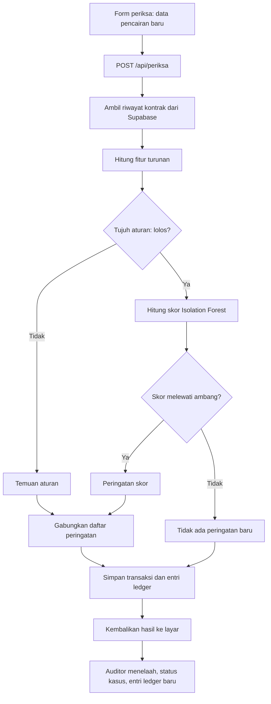

# ARCHITECTURE

Dokumen ini menjelaskan bagaimana bagian-bagian prototipe GSTP terhubung. Spesifikasi rinci tiap bagian ada di `docs/`.

## 1. Gambaran umum

Prototipe terdiri dari tiga tempat kerja:

| Tempat | Bahasa | Dijalankan di | Tugas |
|---|---|---|---|
| `ml/` | Python | Laptop (offline) | Membuat data, melatih model, mengevaluasi, mengekspor artefak |
| `web/` | HTML/CSS/JavaScript + TypeScript (Next.js) | Vercel | Landing Three.js statis di `/`; aplikasi periksa, daftar peringatan, ledger, evaluasi, dan route API di Next.js |
| Database | SQL (Postgres) | Supabase | Menyimpan registri, transaksi, peringatan, dan ledger |

Python tidak berjalan di Vercel. Python menghasilkan artefak (`model_if.json`, `golden_cases.json`, `rules_config.json`, `hasil_evaluasi.json`) yang dibaca oleh `web/`. Alasannya satu: hanya Node.js dan database yang perlu hidup saat demo, sehingga risiko build campuran di Vercel dihindari.

## 2. Tiga lapis GSTP dan pemetaannya

| Lapis (konsep esai) | Isi | Di prototipe |
|---|---|---|
| Integrasi data | Menerima dan menautkan seri, proyek, kontrak, pengeluaran, dan bukti | Tabel registri dan transaksi, route `/api/periksa` |
| Ledger | Metadata, hash, waktu, status verifikasi, jejak persetujuan dan perubahan | Tabel `ledger_entri` dengan hash-chain, `docs/LEDGER_SPEC.md` |
| Analitik | Pemeriksaan aturan dan skor anomali | `web/lib/aturan.ts`, `web/lib/iforest.ts`, model dilatih di `ml/` |

Cocokkan nama lapis ini dengan istilah di teks esai sebelum dipakai di slide atau laporan.

## 3. Alur data untuk satu pemeriksaan transaksi



Catatan penting:
- Transaksi yang melanggar aturan tetap masuk daftar peringatan tanpa perlu skor. Ini sesuai alur di Gambar 1 esai.
- Fitur turunan (hari sejak pencairan sebelumnya, kumulatif, delta progres, dan lainnya) dihitung server dari riwayat di database. Pengguna tidak mengisinya.
- Peringatan adalah prioritas pemeriksaan, bukan penetapan fraud.

## 4. Komponen

### `ml/` (Python, offline)
- `generate_gstp_data.py`: generator data simulasi.
- `gstp/aturan.py`: tujuh aturan.
- `gstp/fitur.py`: fitur turunan dan fitur model.
- `gstp/model.py`: pelatihan dan penentuan ambang Isolation Forest.
- `gstp/ledger.py`: hash-chain untuk membangun ledger awal.
- `run_evaluasi.py`: evaluasi tiga pendekatan dan beberapa seed.
- `export_artifacts.py`: menulis artefak untuk web.
- `tests/`: tes Python.

### `web/` (landing statis dan Next.js)
- `public/index.html`, `public/landing.js`, `public/landing.css`: landing mandiri dengan Three.js langsung, tanpa React atau halaman Next.js.
- `public/landing-data/` dan `public/vendor/three/`: data JSON simulasi dan modul Three.js lokal.
- `app/`: halaman aplikasi (lihat `docs/WEB_SPEC.md`) dan route API (lihat `docs/API_SPEC.md`). Rute `/` ditulis ulang ke dokumen landing statis.
- `lib/aturan.ts`, `lib/fitur.ts`, `lib/iforest.ts`: padanan TypeScript dari Python.
- `lib/ledger.ts`: SHA-256, rantai, verifikasi.
- `lib/store.ts`: satu-satunya lapisan akses data. Halaman dan route tidak boleh memanggil Supabase langsung.
- `data/artifacts/`: salinan artefak dari `ml/artifacts/`.
- `tests/`: tes kesesuaian terhadap `golden_cases.json`.

### Database
Lihat `docs/DATABASE_SPEC.md`. Akses hanya dari server dengan service role key.

## 5. Topologi deploy

```
Browser  ->  Vercel (landing HTML statis + Next.js: halaman aplikasi dan route API)
                 |-- membaca data/artifacts/*.json (ikut ter-bundle)
                 '-- Supabase Postgres (service role, hanya dari server)
```

- Vercel root directory: `web`.
- Rahasia hanya di environment variable Vercel dan `.env.local` lokal.
- Ledger dan peringatan ditulis hanya melalui route API.

## 6. Keamanan

- Service role key tidak pernah dikirim ke browser.
- Row Level Security aktif di semua tabel tanpa kebijakan publik.
- Route penulisan dijaga kode akses sederhana dan pembatasan laju (`docs/API_SPEC.md`).
- Endpoint perusakan entri hanya aktif jika `DEMO_MODE=true`.
- Tidak ada data pribadi di prototipe. Data sensitif pada rancangan penuh disimpan off-chain terenkripsi, dan itu tidak dibangun di sini.

## 7. Keputusan arsitektur yang memengaruhi bagian lain

| Keputusan | Dampak | Dokumen |
|---|---|---|
| Skor dihitung di TypeScript | Perlu tes kesesuaian Python dan TypeScript | `docs/EXPORT_SPEC.md` |
| Ledger berupa hash-chain di Postgres | Bukan Hyperledger Fabric, harus disebut simulasi | `docs/LEDGER_SPEC.md`, `docs/LIMITATIONS.md` |
| Satu lapisan akses data | Database bisa diganti tanpa mengubah halaman | `web/lib/store.ts` |
| Data simulasi dibuat sendiri | Hasil evaluasi adalah bukti awal, bukan klaim umum | `docs/DATA_SPEC.md`, `docs/LIMITATIONS.md` |

Alasan lengkap tiap keputusan ada di `docs/DECISIONS.md`.
